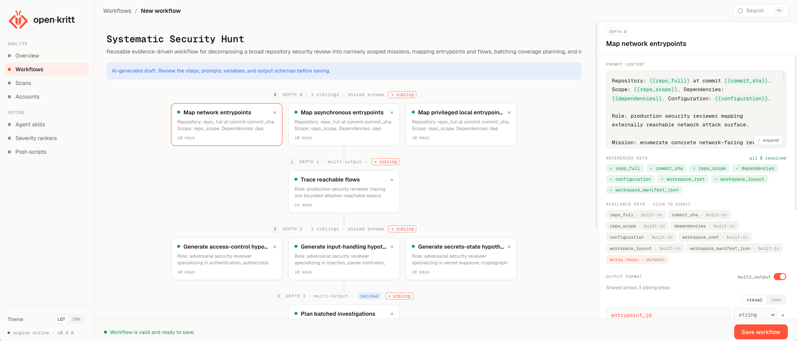

> **[中文化] open-kritt**
>
> 此项目是 [Kritt-ai/open-kritt](https://github.com/Kritt-ai/open-kritt) 的中文翻译版本。
> - 原项目 Stars: 2284
> - 主语言: JavaScript
> - 许可证: AGPL-3.0
> - 翻译日期: 2026-10-14
> - 原始 README: [README_en.md](README_en.md)
>
> 说明：下方 README 正文为**原项目文档的中文翻译**，力求忠于原文；本页顶部的「中文快速上手」为**面向中文用户的补充导读**（非原文内容），目的是让你不用读完整篇 README 就能先把项目跑起来。
>
> 如有翻译不准确之处，欢迎提 Issue 或 PR。

---


## 🚀 中文快速上手（补充导读，非原文）

### 这是什么 / 解决什么问题

open·kritt 是一个开源、可自托管的 AI 安全与漏洞研究平台。它不把整个代码仓库直接丢给模型，而是把研究拆成小而明确的任务，交给多个 AI agent 并行执行，再把结果合并成可验证、可排序的漏洞发现。它面向安全研究人员和关注安全的开发者，让他们能自己掌控提示词、工作流、模型供应商和基础设施。

### 快速上手（最短路径）

前置条件：需要 Git、带 Docker Compose 的 Docker、Node.js 20 或更新版本。仓库自带的 CLI 无需安装步骤。

1. 克隆仓库并进入目录：
   ```bash
   git clone https://github.com/Kritt-ai/open-kritt
   cd open-kritt
   ```
2. 运行初始化（会引导你完成可用的登录方式和 API Key 配置）：
   ```bash
   ./kritt setup
   ```
3. 启动服务栈：
   ```bash
   ./kritt start
   ```
4. 服务启动后，在浏览器打开 [http://localhost:5173](http://localhost:5173)。
5. 若在无浏览器/无桌面的服务器上，保持服务栈运行，另开一个 shell 使用无头 CLI：
   ```bash
   ./kritt-headless
   ```

### 环境要求

- 操作系统：原文未说明具体支持的系统，仅提到可在「无浏览器或桌面的服务器」上运行。
- 硬件：原文未说明具体硬件要求。
- 依赖：Git、Docker（含 Docker Compose）、Node.js 20 或更新版本。
- 版本要求：Node.js 20+；其余依赖版本原文未说明。
- 模型访问：至少需要一种模型访问方式（Codex 登录，或通过 OpenAI、Anthropic、DeepSeek、OpenRouter、xAI 连接）。
- 网络：国内网络环境下载 Docker 镜像或 npm 依赖时，可能需要更换镜像源/加速下载（原文未提及，此为通用提示）。

### 常见坑与注意事项

- **默认无应用层认证**：默认端口绑定在 `127.0.0.1`，后端不包含应用认证，必须保持服务栈私有，不要对外暴露。
- **agent 以 root 运行**：启用工具的 agent 会在一次性 job 容器内以 root 身份运行，拥有可写的仓库副本和直接互联网访问权限，用于安装工具、编译目标、运行测试和构建 PoC。扫描不可信代码前，应在专用的 Docker 主机或 VM 上运行，并先阅读威胁模型文档。
- **需要模型访问凭证**：必须配置至少一种模型访问方式（登录或 API Key），`./kritt setup` 会引导完成。`GITHUB_TOKEN` 是可选的，仅在需要访问私有 GitHub 仓库时才需要。
- **无头 CLI 的功能限制**：`./kritt-headless` 不会在终端显示漏洞发现的内容，仅显示扫描状态、阶段和失败原因等。

---


---

<div align="center">

<picture>
  <source media="(prefers-color-scheme: dark)" srcset="docs/images/logo-dark.png" />
  
</picture>

# open·kritt

**编排 AI 智能体，发现代码中的真实漏洞。**

一个开源、自托管的安全与漏洞研究平台，将聚焦的 AI 分析转化为去重、排序后的发现，并支持可配置的验证与增强。

[](LICENSE)
[](https://github.com/Kritt-ai/open-kritt/releases)

[网站](https://kritt.ai) ·
[文档](https://docs.kritt.ai) ·
[快速开始](https://docs.kritt.ai/getting-started/installation-and-setup) ·
[贡献指南](CONTRIBUTING.md) ·
[所有者](OWNERSHIP.md) ·
[研究论文](https://kritt.ai/open-kritt-launch)

<a href="https://t.co/WzXMUKWxcR"></a>
<a href="https://x.com/Kritt_AI"></a>

</div>



## open·kritt 是什么？

把一个模型指向整个仓库、让它找漏洞，效果通常很差。open·kritt 采用聚焦式方法：把研究拆成小而明确的任务，让多个 AI 智能体并行执行，再将输出汇总为可验证、可排序的发现。

它面向安全研究人员和有安全意识的开发者，让你掌控自己的提示词、工作流、模型提供商和基础设施。

### 功能

- **构建工作流** — 将聚焦的提示词串联成可复用的安全研究手册。
- **运行扫描** — 使用 Codex、Claude Code 或 Grok Build 分析远程或本地仓库及其依赖。
- **验证发现** — 用后置脚本验证问题、构建概念验证并生成报告。
- **导出扫描结果** — 将规范化发现、结构化数据、后处理输出、报告和概念验证打包为一个 ZIP 归档，并附带可安全分享的清单；已完成的扫描生成完整导出，而已停止或失败但包含发现的扫描生成明确标记的部分导出。受攻击者影响的报告和 PoC 源码以纯文本保留。
- **结果排序** — 应用自定义严重性排序器、统一的发现 Schema 和自动去重。
- **自带模型访问** — 使用 Codex 登录，或通过 OpenAI、Anthropic、DeepSeek、OpenRouter 或 xAI 连接。

> **源自真实安全研究。** Kritt 团队以研究员名 **Blockian** 获得了超过 **$1,500,000 的漏洞赏金**
> （[Immunefi](https://immunefi.com/profile/Blockian/) ·
> [HackenProof](https://hackenproof.com/hackers/Blockian) ·
> [blockian.xyz](https://blockian.xyz) · [@Kritt_AI](https://x.com/Kritt_AI)）。
> open·kritt 是支撑这些工作的内部项目的开源提炼版。

## 快速开始

你需要 Git、带 Docker Compose 的 Docker，以及 Node.js 20 或更高版本。仓库自带的 CLI 无需安装步骤。

```bash
git clone https://github.com/Kritt-ai/open-kritt
cd open-kritt
./kritt setup
./kritt start
```

服务栈运行后，打开 [http://localhost:5173](http://localhost:5173)。你只需一种模型访问方式；`./kritt setup` 会引导你完成可用的登录和 API 密钥配置。`GITHUB_TOKEN` 是可选的，仅在访问私有 GitHub 仓库时需要。

在没有浏览器或桌面的服务器上，让服务栈保持运行，另开一个 shell：

```bash
./kritt-headless
```

无头 CLI 可导入可移植的工作流、后置脚本、技能和排序器 JSON；创建扫描时使用与 Web 表单相同的后端验证；显示扫描状态、阶段和失败原因；编辑非敏感的运行时设置；并导出发现包。它不会在终端中显示发现内容。参见[无头 CLI 指南](docs-site/getting-started/headless-cli.mdx)。

默认端口绑定到 `127.0.0.1`，且后端不包含应用认证。请保持服务栈私有。

启用工具的智能体在一次性作业容器中以 root 身份运行，拥有可写的仓库副本和直接互联网访问，以便安装工具、编译目标、运行测试和构建概念验证。请在专用 Docker 主机或 VM 上运行 open·kritt；扫描不受信任的代码前，请先阅读[威胁模型](docs/threat-model.md)。

关于前置条件、手动 Docker 设置和特定提供商的说明，请阅读[安装指南](docs-site/getting-started/installation-and-setup.mdx)和 [AI 提供商设置](docs-site/ai-provider-setup/overview.mdx)。

在 **Accounts** 中，使用持久化的 **Active** 开关选择哪些账户可以接收新任务，同时保留其他凭据。参见[活跃提供商账户](docs/account-activity.md)。

## 文档

使用 Mint 在本地预览文档：

```bash
npm install -g mint
cd docs-site
npm run dev
```

打开 [http://localhost:3001](http://localhost:3001) 查看站点。

- [产品概览](docs-site/getting-started/welcome.mdx)
- [无图形界面使用 open·kritt](docs-site/getting-started/headless-cli.mdx)
- [运行你的第一次扫描](docs-site/first-scan/workflow.mdx)
- [工作流与提示词步骤](docs-site/workflows/steps.mdx)
- [安全与威胁模型](docs/threat-model.md)

## 社区与贡献

open·kritt 由 [Harel Rom (`@harel-coffee`)](https://github.com/harel-coffee) 和 [Gabriel Balko (`@GabiCtrlZ`)](https://github.com/GabiCtrlZ) 共同拥有和维护。详情参见[项目所有权与版权](OWNERSHIP.md)。

问题和想法请发到 [GitHub Discussions](https://github.com/Kritt-ai/open-kritt/discussions)。Bug 和功能请求请使用 [GitHub Issues](https://github.com/Kritt-ai/open-kritt/issues)。

欢迎贡献。开发环境搭建、测试命令和 Conventional Commit 要求请阅读 [CONTRIBUTING.md](CONTRIBUTING.md)。

请按照 [SECURITY.md](SECURITY.md) 私下报告安全漏洞，不要通过公开 Issue 报告。

## 许可证

open·kritt 采用 [GNU Affero General Public License v3.0](LICENSE) 许可。